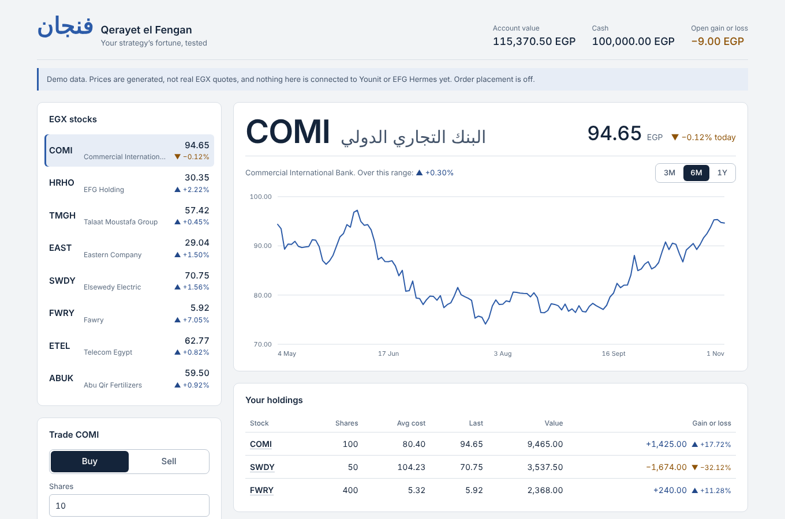
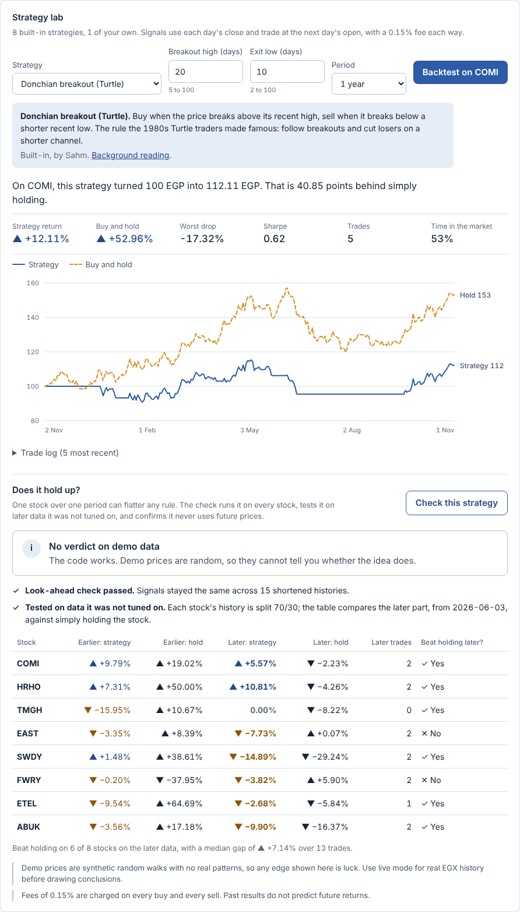

# Sahm · سهم

**An open-source strategy lab for the Egyptian Exchange.** Test well-known technical strategies, or your own, on EGX stocks, with backtests that are honest about what they can and cannot show. Built on [Younit by EFG Hermes](https://github.com/efg-hermes-younit/younit-python), Egypt's first retail algorithmic trading API.

[](https://github.com/omar06khaled/sahm/actions/workflows/ci.yml)
[](LICENSE)




> Independent open-source project, not affiliated with or endorsed by EFG Hermes. Backtests are historical simulations, not predictions or investment advice.

## Why

Younit gives retail traders and students in Egypt an API to automate trading. Before you automate a rule, you want to know whether it would have worked. Most backtests make that too easy: they let a rule peek at future prices by accident, they get tuned until the past looks perfect, and they report a lucky streak as an edge. Sahm is built to catch all three.

## What's inside

- **A strategy library.** Eight classic technical strategies, ready to run on any EGX stock.
- **Your own strategies.** Write one Python function, drop the file into `strategies/`, and it appears in the dashboard and the AI tools, with its settings form built for you.
- **A backtest lab.** Run a strategy on one stock and see its growth against simply holding the stock, with fees, drawdown, Sharpe ratio and a trade log.
- **A strategy check.** One click runs the strategy across your watchlist and tells you whether it holds up (details below).
- **A dashboard** with your holdings, price charts and a guarded order ticket, in English with Arabic company names.
- **An MCP server** so AI assistants like Claude can list, backtest and check strategies for you.
- **Works offline** on synthetic demo data, and on your real Younit account through the official SDK.

## The strategy check



**Check this strategy** runs three tests and gives a verdict in plain words:

1. **Look-ahead guard.** It reruns the strategy on histories cut short at 15 points. If any past signal changes when future days are removed, the strategy is using prices it could not have known, and the report says so.
2. **Out-of-sample test.** Each stock's history is split 70/30. Rules are usually tuned on the earlier part, so the verdict comes only from the later part, compared against simply holding the stock.
3. **Luck check.** It states how often a random rule would beat holding on as many stocks, so a lucky streak is not mistaken for skill.

Synthetic demo prices are random walks, so the check never gives a verdict on them: it confirms the code works and asks for real EGX history.

## Built-in strategies

| Strategy | The idea |
|---|---|
| Buy and hold | The baseline every rule has to beat |
| Moving-average crossover | Hold while the fast average is above the slow one |
| Exponential average crossover | The same, weighting recent prices more |
| MACD signal line | Hold while MACD is above its signal line |
| RSI mean reversion | Buy when oversold, sell when overbought |
| Bollinger band bounce | Buy below the lower band, sell back at the middle |
| Donchian breakout (Turtle) | Buy breakouts above the recent high, cut losers on a shorter low |
| Time-series momentum | Hold while the stock is up over the lookback |

## Write your own

```python
# strategies/price_above_average.py
from sahm.strategies import Param, closes, hold_while, indicators as ind, strategy


@strategy(
    id="price_above_average",
    name="Price above its average",
    summary="Hold while the close is above its moving average.",
    params=[Param("days", "Average (days)", 50, 5, 250)],
    author="Your name",
)
def price_above_average(bars, p):
    c = closes(bars)
    avg = ind.sma(c, p["days"])
    return hold_while([a is not None and price > a for price, a in zip(c, avg)])
```

Return 1 to hold the stock and 0 to hold cash, one value per day. The full guide, with the available indicators and helpers, is in [STRATEGIES.md](STRATEGIES.md).

## Quick start

You need Python 3.10 or newer. The dashboard comes prebuilt, so Node.js is only needed if you change the frontend.

**Windows (PowerShell)**

```powershell
git clone https://github.com/omar06khaled/sahm.git
cd sahm
py -m venv .venv
.\.venv\Scripts\python.exe -m pip install -e ".[web]"
.\.venv\Scripts\sahm-dashboard.exe
```

**macOS / Linux**

```bash
git clone https://github.com/omar06khaled/sahm.git
cd sahm
python3 -m venv .venv
.venv/bin/pip install -e ".[web]"
.venv/bin/sahm-dashboard
```

Open http://127.0.0.1:8000. It starts on demo data with order placement off. If port 8000 is taken, run `sahm-dashboard --port 8001`.

## Connect your Younit account

1. Install the official SDK from its source (it is not on PyPI yet): `pip install path/to/younit-python`.
2. Copy `.env.example` to `.env` and fill in `TRADING_ID` and `API_KEY` from EFG Hermes ONE.
3. Set `YOUNIT_MODE=live`, then start `sahm-dashboard` again.

Live mode uses Younit's **simulation (paper-trading) environment** unless you set `YOUNIT_REAL_MONEY=true`, and the dashboard always shows which one it is connected to.

## Safety

- **Order placement is off** until `YOUNIT_TRADING_ENABLED=true`.
- **Every order is previewed first.** The preview returns a one-time token that expires after 120 seconds; only confirming it places the order.
- **Every order is capped** at `YOUNIT_MAX_ORDER_EGP` (default 5,000 EGP). Market orders are priced at the last price, so they are capped too.
- **Credentials stay in your `.env`,** which git ignores. The official SDK reads them and never logs them.

## Use it from an AI assistant

`sahm-mcp` is an MCP server with 12 tools, including `list_strategies`, `backtest_strategy` and `check_strategy`.

```bash
claude mcp add sahm --transport stdio -- /absolute/path/to/sahm/.venv/bin/sahm-mcp
```

For full AI access to a Younit account (30 tools, funds, streaming), use the official SDK's `younit-mcp` alongside it; the command names never clash.

## How it fits together

```
Browser (React)            AI assistant
      | HTTP                     | MCP (stdio)
   api.py                    server.py
      \__________ shared ________/
   strategies/   library, your files, look-ahead guard, report card
   backtest.py   signals at the close, fills at the next open, fees both ways
   orders.py     preview, one-time confirm, EGP cap
   broker/       BrokerClient interface
     |-- mock.py     synthetic EGX prices (offline)
     \-- younit.py   official younit-sdk Client
```

```
src/sahm/        Python package: API, MCP server, backtester, strategy library, brokers
strategies/      your strategy files (an example is included)
web/             React + TypeScript dashboard (prebuilt into web/dist)
tests/           pytest suite, including the gate every strategy must pass
```

## Contributing

New strategies are the best contribution. Add a file to `strategies/`, run `pytest -q`, and open a pull request with its report card from real EGX history. CI runs every strategy through the look-ahead guard and an import filter, and a person reads every pull request. See [STRATEGIES.md](STRATEGIES.md).

To work on the dashboard: `cd web && npm install && npm run dev`, with `sahm-dashboard` running in another terminal.

## License

[MIT](LICENSE). Built by [Omar Nassar](https://github.com/omar06khaled).
